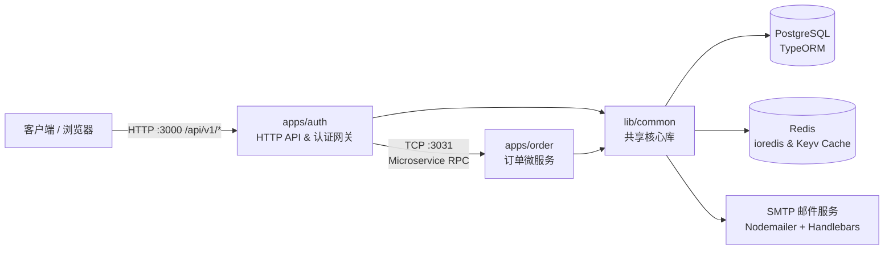
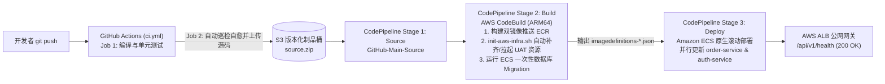

# NestJS Microservices Monorepo (`nestjs-aws`)

基于 **NestJS 12 (Monorepo + SWC)** 构建的微服务测试与云原生部署项目。项目包含对外提供 HTTP API 的网关与认证服务（`auth`）、内部 TCP 订单微服务（`order`）以及共享基础库（`@app/common`），并已完成针对 **AWS ECS Fargate、RDS PostgreSQL、ElastiCache Redis、Secrets Manager 与 KMS** 的生产级容器化与自动化部署适配。

---

## 一、项目架构与核心特性

### 1.1 微服务架构拓扑



### 1.2 技术栈与核心模块

* **工程架构**：NestJS Monorepo 模式（`apps/auth`、`apps/order`、`lib/common`），采用 `@swc/core` 极速编译与 `pnpm` 包管理。
* **认证与鉴权（Authentication & Authorization）**：
  * 集成 `@nestjs/authentication` 与 `@nestjs/authorization`。
  * 支持多策略认证：**Session 会话认证**、**JWT Access Token**、**API Key 认证**、**Magic Link 魔法链接登录**、**邮箱验证**与**密码重置**。
  * 支持基于 RBAC（角色 `Role` / 权限 `Permission`）与策略类（`Policy` + `@Can` 装饰器）的细粒度资源鉴权。
  * 集成 `@nestjs/throttler` 提供全局与账号维度的接口防刷限流。
* **数据持久化（Database & Migrations）**：
  * 基于 **TypeORM + PostgreSQL**，支持实体自动加载、平滑停机连接释放（Shutdown Hooks）及生产环境 AWS RDS SSL 加密连接。
  * 内置完整的 TypeORM Migration 版本迁移机制。
* **多级缓存与 Redis（Cache）**：
  * 同时集成 `@nestjs-modules/ioredis`（原生 Redis 客户端，支持单机 `single` 与集群 `cluster`）与 `@nestjs/cache-manager`（基于 `@keyv/redis` 的 Cache-Aside 缓存管理），兼容 AWS ElastiCache `redis://` 与 `rediss://` (TLS) 协议。
* **邮件服务（Mail）**：
  * 基于 `@nestjs-modules/mailer` + `nodemailer` + `handlebars` (`.hbs`) 模板引擎，支持验证码、欢迎信、密码重置及魔法链接邮件发送。
* **可观测性与异常处理（Logging & Filters）**：
  * 基于 `nestjs-pino` 的结构化日志系统：本地开发支持 `pino-pretty` 彩色终端输出与 `pino-roll` 本地文件按日轮转；生产环境默认输出标准 JSON 至 `stdout` 供 AWS CloudWatch 采集。
  * 全局异常过滤器 `AllExceptionFilter` 统一拦截并格式化 HTTP 异常响应。

---

## 二、目录结构

```text
nestjs-aws/
├── .github/
│   └── workflows/
│       └── ci.yml                   # GitHub Actions CI/CD 流水线 (单测 -> 触发 AWS CodePipeline)
├── apps/
│   ├── auth/                        # 主应用 & API 网关 (HTTP 默认端口 3000)
│   │   ├── src/
│   │   │   ├── auth/                # 认证模块 (Session / JWT / API Key / Magic Link / 邮箱验证 / 密码重置)
│   │   │   ├── client/              # 客户模块
│   │   │   ├── module/user/         # 用户模块 & 跨服务调用 order 微服务示例
│   │   │   ├── permission/          # 权限管理模块
│   │   │   ├── policy/ & _policy/   # 授权策略定义 (OrderPolicy 等)
│   │   │   ├── role/                # 角色管理模块
│   │   │   ├── app.controller.ts    # 基础接口 (健康检查 /api/v1/health、缓存与邮件测试)
│   │   │   ├── app.module.ts        # Auth 根模块
│   │   │   └── main.ts              # Auth 启动入口 (全局前缀、URI 版本控制、CORS、异常过滤)
│   │   └── test/                    # Auth E2E 测试
│   └── order/                       # 订单微服务 (TCP 默认监听 0.0.0.0:3031)
│       ├── src/
│       │   ├── policy/              # 订单访问控制策略
│       │   ├── order.controller.ts  # TCP 消息控制器 (@MessagePattern: findall / findone / findbycustomer)
│       │   ├── order.service.ts     # 订单业务逻辑
│       │   ├── order.module.ts      # Order 根模块
│       │   └── main.ts              # Order TCP 微服务启动入口
│       └── test/                    # Order E2E 测试
├── lib/
│   └── common/                      # 跨应用共享核心库 (@app/common)
│       ├── cache/                   # Redis (ioredis) 与 CacheManager (@keyv/redis) 封装
│       ├── config/                  # 基于 @nestjs/config + Zod 的环境变量强校验模块
│       ├── database/                # TypeORM 动态配置、实体 (Entities)、DataSource 与 Migrations
│       ├── enum/                    # 全局配置枚举 (ConfigEnum)
│       ├── filter/                  # 全局异常过滤器 (AllExceptionFilter)
│       ├── interceptor/             # API Key 拦截器
│       ├── logger/                  # Pino 日志模块与多目标 Transport 封装
│       ├── mail/                    # 邮件模块及 Handlebars (.hbs) 邮件模板
│       └── param/                   # 参数提取工具
├── scripts/
│   ├── init-aws-infra.sh            # AWS UAT 全套基础设施幂等检查与从 0 自动创建脚本 (IaC)
│   ├── destroy-aws-infra.sh         # AWS UAT 计费资源一键彻底销毁脚本 (零残留省钱停机)
│   ├── deploy-aws.sh                # 本地容器构建推送 ECR、RDS 迁移与 ECS 滚动发布脚本
│   ├── setup-aws-codebuild.sh       # AWS CodeBuild (ARM64) 项目与 IAM 角色自动化管理脚本
│   ├── setup-aws-codepipeline.sh    # AWS CodePipeline 三阶段可视化流水线管理与自愈脚本
│   ├── setup-github-oidc.sh         # GitHub Actions 专用最小权限 IAM 账号与 Secrets 自动注入脚本
│   ├── duckdb-quack-server.sh       # DuckDB Quack 云服务器一键管理脚本
│   └── DUCKDB_QUACK_README.md       # DuckDB Quack 脚本使用说明
├── buildspec.yml                    # AWS CodeBuild 构建、基础设施自愈编排、数据库迁移与制品规范
├── Dockerfile                       # 支持多应用构建参数 (APP_NAME=auth|order) 的多阶段 Dockerfile
├── AWS_DEPLOYMENT_GUIDE.md          # AWS 生产/UAT 环境完整部署与 CI/CD 手册
├── nest-cli.json                    # Nest CLI Monorepo 与 SWC 编译配置
└── package.json                     # 项目依赖与全生命周期快捷脚本命令
```

---

## 三、环境要求与本地配置

### 3.1 基础环境要求

* **Node.js**：`>= 24.x`（NestJS 12 + Jest 30 依赖 Node 24 原生 ESM 模块支持）
* **包管理器**：`pnpm`（`>= 10.x`，可通过 `corepack enable` 启用）
* **基础服务**：
  * **PostgreSQL**：`>= 15.x`
  * **Redis**：`>= 6.x`
* **容器与云工具（可选）**：`Podman` 或 `Docker`、`AWS CLI v2`、`GitHub CLI (gh)`

### 3.2 安装依赖

```bash
pnpm install
```

### 3.3 环境变量配置 (`.env`)

在项目根目录创建 `.env` 文件。配置模块（[`lib/common/config/config.module.ts`](lib/common/config/config.module.ts)）在启动时会使用 **Zod** 校验必填项：

```dotenv
# ================= 基础运行配置 =================
NODE_ENV=development
APP_PORT=3000
APP_URL=http://localhost:3000
PREFIX=api
VERSION=1
CORS=true
JWT_SECRET=your_local_jwt_secret_key

# ================= 微服务通信配置 =================
# order 服务监听地址与端口
ORDER_BIND_HOST=0.0.0.0
# auth 服务连接 order 服务的地址与端口
ORDER_SERVICE_HOST=localhost
ORDER_SERVICE_PORT=3031

# ================= PostgreSQL 数据库配置 (SDB_*) =================
SDB_TYPE=postgres
SDB_HOST=localhost
SDB_PORT=5432
SDB_USER=crm
SDB_PASS=your_postgres_password
SDB_DB=typeorm_test
SDB_AUTOLOAD=true
SDB_SSL=false

# ================= Redis 与缓存配置 =================
# REDIS_TYPE 可选: single | cluster
REDIS_TYPE=single
REDIS_URL=localhost:6379
REDIS_PASS=your_redis_password
# 缓存过期时间（单位：毫秒）
CACHE_TIME=60000

# ================= 邮件服务配置 (SMTP) =================
MAIL_HOST=smtp.qq.com
MAIL_PORT=587
MAIL_USER=your_email@qq.com
MAIL_PASS=your_smtp_authorization_code
MAIL_FROM="Admin <your_email@qq.com>"

# ================= 日志配置 =================
# 开发环境若需写入本地日志文件可设为 true，生产环境建议关闭并直接输出至 stdout
LOG_ON=false
LOG_PATH=./logs
LOG_TYPE=daily
```

---

## 四、本地开发与运行

### 4.1 数据库迁移（Migrations）

首次启动或数据表结构变更后，请确保 PostgreSQL 已创建对应数据库（如 `typeorm_test`），然后执行迁移：

```bash
# 先编译项目以生成 dist 目录下的实体与迁移脚本
pnpm build auth

# 执行数据库迁移
pnpm migration:run:prod

# 如需回滚最近一次迁移
pnpm migration:revert:prod
```

### 4.2 启动微服务

本地开发需同时启动 `auth`（HTTP 网关，默认端口 `3000`）和 `order`（TCP 微服务，默认端口 `3031`）：

```bash
# 终端 1：以开发监听模式启动 auth 服务 (http://localhost:3000)
pnpm start:auth:dev

# 终端 2：以开发监听模式启动 order 微服务 (TCP 3031)
pnpm start:order:dev
```

如果需要开启 Debug 调试模式：

```bash
pnpm start:auth:debug
pnpm start:order:debug
```

### 4.3 编译与生产模式运行

```bash
# 编译全部应用
pnpm build

# 生产模式运行 auth 与 order
pnpm start:auth:prod
pnpm start:order:prod
```

---

## 五、常用接口说明

`auth` 服务默认启用全局路由前缀 `/api` 与 URI 版本控制 `/v1`（即基础路径为 `http://localhost:3000/api/v1`）：

| 模块 | 方法与路径 | 说明 |
| :--- | :--- | :--- |
| **系统与基础测试** | `GET /api/v1/health` | 健康检查接口（供负载均衡器 ALB 探测，返回 `{"status":"ok","timestamp":"..."}`） |
| | `GET /api/v1` | 测试 `ioredis` 原生读写与 `cache-manager` Cache-Aside 缓存 |
| | `GET /api/v1/sendmail` | 测试 SMTP 邮件发送与 Handlebars (`.hbs`) 模板渲染 |
| **用户与跨服务调用** | `GET /api/v1/user/findall` | 查询全部用户 |
| | `POST /api/v1/user/create` | 创建新用户 |
| | `GET /api/v1/user/me` | 获取当前登录用户信息 |
| | `GET /api/v1/user/findcustomerorder/:id` | **跨微服务调用示例**：通过 `@Can(OrderPolicy)` 鉴权后，由 `auth` 通过 TCP RPC 调用 `order` 微服务查询指定客户的订单 |
| **认证与安全 (`auth`)** | `/api/v1/auth/*` | 包含账号注册、密码登录、邮箱验证、密码重置、Magic Link 登录、Token 刷新与 API Key 管理等接口 |
| **权限与角色** | `/api/v1/role/*`<br/>`/api/v1/permission/*`<br/>`/api/v1/policy/*` | 角色、权限与访问控制策略的 CRUD 接口 |

---

## 六、代码检查与测试

```bash
# 使用 oxlint 进行类型感知静态代码检查
pnpm lint

# 使用 Prettier 格式化代码
pnpm format

# 运行单元测试
pnpm test

# 监听模式运行单元测试
pnpm test:watch

# 生成测试覆盖率报告
pnpm test:cov

# 运行全部微服务 (auth & order) 的 E2E 端到端测试
pnpm test:e2e
```

---

## 七、容器化构建、CI/CD 流水线与 AWS 云上部署

本项目采用单 [`Dockerfile`](Dockerfile) 多阶段构建设计，通过 `--build-arg APP_NAME=auth` 或 `order` 分别打包对应微服务镜像，并内置了**从 GitHub Actions CI 到 AWS CodePipeline 三阶段可视化流水线 + UAT 基础设施从 0 自动自愈编排**的完整云原生交付闭环。

### 7.1 全自动 CI/CD 与 AWS CodePipeline 三阶段可视化架构



#### （1）全新环境首次一次性初始化（仅需执行一次）

在配置好本地 `aws configure` 与 `gh auth login` 后，按顺序执行以下 3 条命令即可完成云端流水线与 GitHub 仓库密钥绑定：

```bash
# 1. 创建 AWS CodeBuild 项目 (nestjs-aws-cicd) 与 IAM 服务角色
pnpm codebuild:setup

# 2. 创建 AWS CodePipeline 三阶段可视化流水线 (nestjs-aws-pipeline) 与 S3 版本化制品桶
pnpm codepipeline:setup

# 3. 创建 GitHub CI 最小权限 IAM 账号并自动加密写入 GitHub Actions Secrets
pnpm github:cd:setup
```

#### （2）日常全自动发布（支持从 0 自动自愈拉起 UAT 资源）

无论是日常迭代，还是在执行了 `pnpm aws:destroy`（甚至删掉了 CodeBuild/CodePipeline）之后重新从 0 拉起环境，都**只需执行以下任一操作**：

```bash
# 方式 A（推荐）：直接推送代码到 main 分支，自动触发 GitHub CI -> AWS CodePipeline 全流程
git push origin main

# 方式 B：不改代码，在本地直接打包当前代码触发 AWS CodePipeline 三阶段流水线
pnpm codepipeline:start

# 随时在终端查看 CodePipeline 三个阶段 (Source -> Build -> Deploy) 的实时状态
pnpm codepipeline:status
```

### 7.2 本地手动构建与运维命令（可选）

```bash
# 本地使用 Podman 构建生产镜像 (linux/arm64)
pnpm image:build:auth
pnpm image:build:order

# 在本地直接检查/创建全套 AWS UAT 基础设施 (VPC/SG/KMS/Secrets/RDS/Redis/ALB/ECS)
pnpm aws:init

# 在本地使用容器引擎构建推送双镜像 -> 执行 RDS Migration -> 滚动更新 ECS 服务
pnpm aws:deploy
pnpm aws:push      # 仅构建并推送 auth 与 order 镜像至 Amazon ECR
pnpm aws:migrate   # 仅启动 ECS Fargate 一次性任务执行 TypeORM Migration
pnpm aws:rollout   # 仅触发 ECS order-service 与 auth-service 强制滚动更新
```

### 7.3 AWS 资源销毁与零账单停机命令

```bash
# 【常用推荐】一键销毁所有按小时计费的 UAT 运行资源（ECS/ALB/RDS/Redis/ECR/Secrets/KMS/SG）
# 执行后 AWS 产生费用归零；下次 git push 时会自动从 0 重新拉起全套资源
pnpm aws:destroy

# 【彻底清空】将 UAT 资源 + CodePipeline + S3 制品桶 + CodeBuild 项目全部删除
pnpm aws:destroy && pnpm codepipeline:destroy && pnpm codebuild:destroy
```

### 7.4 全生命周期脚本命令速查表

| 分类 | 命令 | 对应脚本 | 说明 |
| :--- | :--- | :--- | :--- |
| **CI/CD 流水线** | `pnpm codepipeline:setup` | [`scripts/setup-aws-codepipeline.sh`](scripts/setup-aws-codepipeline.sh) | 创建/更新三阶段 CodePipeline（若底层 CodeBuild 缺失会自动补齐） |
| | `pnpm codepipeline:start` | [`scripts/setup-aws-codepipeline.sh`](scripts/setup-aws-codepipeline.sh) | 自动巡检自愈 CI/CD 组件、上传最新代码并启动 CodePipeline |
| | `pnpm codepipeline:status` | [`scripts/setup-aws-codepipeline.sh`](scripts/setup-aws-codepipeline.sh) | 查看 CodePipeline `Source -> Build -> Deploy` 各阶段状态 |
| | `pnpm codepipeline:destroy` | [`scripts/setup-aws-codepipeline.sh`](scripts/setup-aws-codepipeline.sh) | 删除 CodePipeline、IAM 角色并清空删除 S3 版本化制品桶 |
| | `pnpm codebuild:setup` | [`scripts/setup-aws-codebuild.sh`](scripts/setup-aws-codebuild.sh) | 创建/更新 ARM64 CodeBuild 项目（`nestjs-aws-cicd`） |
| | `pnpm codebuild:start` | [`scripts/setup-aws-codebuild.sh`](scripts/setup-aws-codebuild.sh) | 单独触发 CodeBuild 云端构建与部署 |
| | `pnpm codebuild:destroy-uat` | [`scripts/setup-aws-codebuild.sh`](scripts/setup-aws-codebuild.sh) | 在云端 CodeBuild 容器内远程执行 UAT 资源销毁 |
| | `pnpm codebuild:status` | [`scripts/setup-aws-codebuild.sh`](scripts/setup-aws-codebuild.sh) | 查看 CodeBuild 项目配置与最近 5 次构建记录 |
| | `pnpm codebuild:destroy` | [`scripts/setup-aws-codebuild.sh`](scripts/setup-aws-codebuild.sh) | 删除 CodeBuild 项目、IAM 角色与构建日志组 |
| | `pnpm github:cd:setup` | [`scripts/setup-github-oidc.sh`](scripts/setup-github-oidc.sh) | 创建最小权限 IAM 用户并将加密凭据注入 GitHub Actions Secrets |
| **AWS 基础设施** | `pnpm aws:init` | [`scripts/init-aws-infra.sh`](scripts/init-aws-infra.sh) | 幂等检查并从 0 创建 ECR/KMS/Secrets/SG/RDS/Redis/ALB/ECS |
| | `pnpm aws:destroy` | [`scripts/destroy-aws-infra.sh`](scripts/destroy-aws-infra.sh) | 一键销毁全部 UAT 计费资源，停止账单计费 |
| | `pnpm aws:deploy` | [`scripts/deploy-aws.sh`](scripts/deploy-aws.sh) | 本地打包推送 ECR + 运行数据库迁移 + ECS 滚动更新 |
| **DuckDB 节点** | `pnpm quack:create` / `status` / `ssh` / `destroy` | [`scripts/duckdb-quack-server.sh`](scripts/duckdb-quack-server.sh) | 详见 [`scripts/DUCKDB_QUACK_README.md`](scripts/DUCKDB_QUACK_README.md) |

> 有关 VPC 子网规划、安全组最小权限配置、KMS 密钥与 Secrets Manager 机密注入、RDS PostgreSQL、ElastiCache Redis、ECS Service Connect 内网通信、ALB 负载均衡及 CI/CD 流水线的详细说明，请参阅项目根目录下的 **[《AWS 生产环境完整部署手册》(AWS_DEPLOYMENT_GUIDE.md)](AWS_DEPLOYMENT_GUIDE.md)**。
